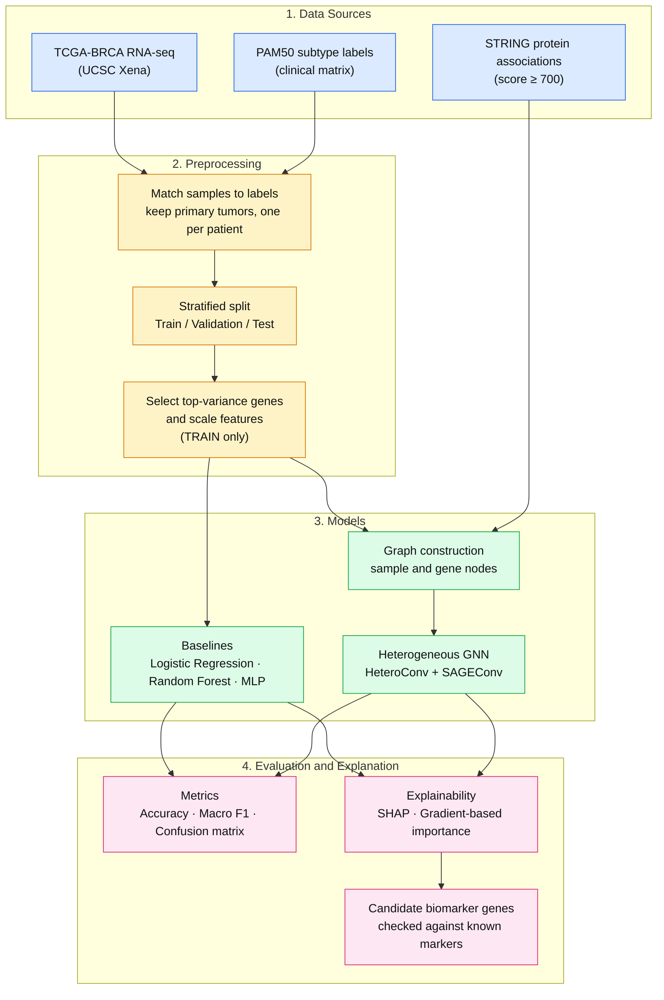
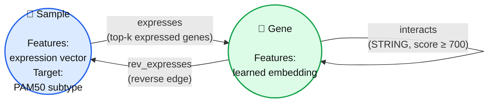
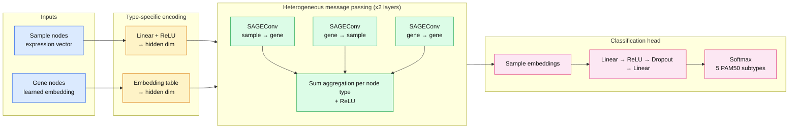
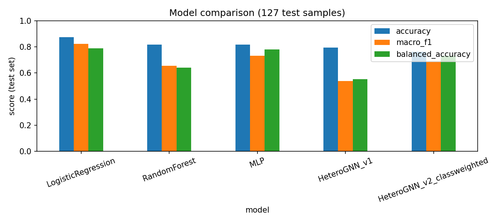

<div align="center">

# 🧬 CancerGraph

### An Explainable Heterogeneous Graph Neural Network for Breast Cancer Molecular Subtype Classification and Biomarker Discovery Using Transcriptomic Data


**Deep Learning Lab Micro Project** · Mar Athanasius College of Engineering

</div>

> ⚠️ **Disclaimer:** This is a research and educational project. Model outputs are **not** clinical diagnoses.

---

## 📑 Table of Contents

1. [Overview](#-overview)
2. [Research Question and Objectives](#-research-question-and-objectives)
3. [System Architecture](#-system-architecture)
4. [Graph Schema](#-graph-schema)
5. [Model Architecture](#-model-architecture)
6. [Data](#-data)
7. [Methodology](#-methodology)
8. [Evaluation Protocol](#-evaluation-protocol)
9. [Explainability and Biomarker Discovery](#-explainability-and-biomarker-discovery)
10. [Results](#-results)
11. [Project Structure](#-project-structure)
12. [Setup and Usage](#-setup-and-usage)
13. [Limitations](#-limitations)
14. [Roadmap](#-roadmap)
15. [Author](#-author)
16. [References and Acknowledgements](#-references-and-acknowledgements)

---

## 🔬 Overview

Breast cancer is not a single disease. It is divided into **molecular subtypes** (PAM50): **Luminal A, Luminal B, HER2-enriched, Basal-like and Normal-like**. Each behaves differently and is treated differently.

Most machine learning models treat genes as independent columns in a table. In reality, genes and proteins work together in networks. **CancerGraph** tests whether adding this biological network structure helps a model classify subtypes, and whether the model can point to genes that may serve as **candidate biomarkers**.

**Key idea:** represent tumor samples and genes as a *heterogeneous graph* (two node types, several edge types) and let a GNN learn from both the expression data and the gene interaction network.

The project does **not** assume the graph model will win. If it does not beat simple baselines, that is reported as a valid finding.

---

## 🎯 Research Question and Objectives

**Research question:**
> Does integrating transcriptomic profiles with a gene interaction network improve breast cancer molecular subtype classification, and can the resulting model identify stable, interpretable candidate biomarker genes?

**Objectives**

1. Prepare TCGA-BRCA gene expression data with PAM50 subtype labels.
2. Build a heterogeneous graph of samples and genes using STRING interactions.
3. Train a heterogeneous GNN for subtype classification.
4. Compare it fairly against Logistic Regression, Random Forest and an MLP.
5. Explain predictions and rank candidate biomarker genes.
6. Check whether top genes agree with known breast cancer markers.
7. Keep the pipeline reproducible and free of data leakage.

---

## 🏗️ System Architecture

End-to-end pipeline from raw data to results. Steps marked **TRAIN only** are fitted on the training set and then applied to validation and test data to avoid leakage.



---

## 🕸️ Graph Schema

The graph has **two node types** and **three edge types**.



| Element | Type | Description |
|---|---|---|
| Sample | Node | One tumor sample. Input features are its (scaled) expression of the selected genes. This is the node we classify. |
| Gene | Node | One selected gene. Starts with a learned embedding. |
| `sample → gene` (expresses) | Edge | Connects a sample to its top-k most highly expressed genes. |
| `gene → sample` (rev_expresses) | Edge | Reverse of the above so that messages flow both ways. |
| `gene ↔ gene` (interacts) | Edge | Gene-gene associations from STRING above a confidence threshold. |

**Setting:** transductive. All samples appear in the graph, but **only training labels are used in the loss**. Subtype labels are never used as input features.

---

## 🧠 Model Architecture



**How it works in simple words**

1. Sample nodes carry expression values. Gene nodes carry learned embeddings.
2. Each edge type has its **own** SAGEConv, so "sample expresses gene" is treated differently from "gene interacts with gene".
3. Over two layers, a sample node gathers information from its expressed genes, and those genes in turn carry information from their interacting partners.
4. The final sample embedding goes through a small MLP to predict the subtype.

**Baselines for comparison**

| Model | Purpose |
|---|---|
| Logistic Regression | Simple linear reference |
| Random Forest | Strong non-linear tabular baseline |
| MLP | Non-graph deep learning baseline |
| Heterogeneous GNN | Proposed model |

---

## 📦 Data

Raw data is **not** stored in this repository. Download it from the sources below.

| Data | Source | Used for |
|---|---|---|
| TCGA-BRCA gene expression | [UCSC Xena](https://xenabrowser.net/) | Sample features |
| PAM50 subtype labels (clinical matrix) | [UCSC Xena](https://xenabrowser.net/) | Classification target |
| Protein-protein associations | [STRING](https://string-db.org/) | Gene-gene edges |

**Record in the notebook:** download date, dataset version, sample count, gene count, class distribution and every filtering decision.

> STRING reports functional *associations*, which are not always direct physical interactions.

---

## ⚙️ Methodology

### 1. Preprocessing
- Match expression samples to PAM50 labels; drop samples without a label.
- Keep primary tumor samples only and **one sample per patient** (the TCGA patient ID is the first 12 characters of the sample barcode).
- Check missing values and duplicate gene names.

### 2. Leakage control
- Split first, then fit anything that learns from data.
- **Gene selection** (top ~1,000 most variable genes) and **scaling** are fitted on training samples only.
- Labels are never used as features.
- Only training labels contribute to the GNN loss.

### 3. Graph construction
- Map STRING proteins to the selected gene symbols.
- Keep edges with confidence score ≥ 700; remove duplicates and self-loops.
- Connect each sample to its top-k (about 50 to 100) most highly expressed genes to keep the graph small.
- Add reverse edges explicitly.

### 4. Training
- Cross-entropy loss (with class weights if the training distribution is imbalanced).
- Adam optimizer, dropout, weight decay.
- Early stopping on validation loss; best checkpoint saved.
- Fixed random seed (`SEED = 42`).

---

## 📏 Evaluation Protocol

- Stratified train / validation / test split (for example 70 / 15 / 15), identical for all models.
- Test set is used **once**, at the end.
- Metrics: **accuracy, macro F1, balanced accuracy, per-class precision and recall, confusion matrix**.
- Macro F1 is emphasised because the subtypes are imbalanced (Luminal A is the largest class).
- Later stages add multiple seeds and report mean ± standard deviation.

---

## 🔍 Explainability and Biomarker Discovery

| Model | Method |
|---|---|
| Random Forest | SHAP feature importance |
| Heterogeneous GNN | Gradient-based gene importance (GNNExplainer planned for a later stage) |

**Biomarker check:** the top-ranked genes per subtype are compared with well-known breast cancer markers:

| Subtype | Expected markers |
|---|---|
| Luminal A / B | ESR1, PGR, GATA3, FOXA1 |
| HER2-enriched | ERBB2 |
| Basal-like | KRT5, KRT14 |

> Important: model importance does **not** prove causality. The genes found are **candidate** biomarkers and need independent biological validation.

---

## 📊 Results

*To be filled in after experiments are run.*

| Model | Accuracy | Macro F1 | Balanced Accuracy | Training time |
|---|---|---|---|---|
| Logistic Regression | – | – | – | – |
| Random Forest | – | – | – | – |
| MLP | – | – | – | – |
| Heterogeneous GNN | – | – | – | – |

**Figures (to be added):** class distribution, training curves, confusion matrices, model comparison chart, top genes per subtype.

---

## 📁 Project Structure

```
CancerGraph/
├── README.md
├── requirements.txt
├── .gitignore
├── notebooks/
│   └── cancergraph_stage1.ipynb     # main Colab notebook
├── data/                            # not committed (download instructions only)
├── results/                         # tables, figures, saved metrics
└── src/                             # added in later stages
    ├── preprocessing.py
    ├── graph_builder.py
    ├── baselines.py
    ├── model.py
    ├── train.py
    ├── evaluate.py
    └── explainability.py
```

---

## 🚀 Setup and Usage

Runs on free **Google Colab** (CPU is sufficient).

```bash
git clone https://github.com/Mariya98rose/CancerGraph.git
cd CancerGraph
pip install torch torch_geometric shap scikit-learn pandas numpy matplotlib seaborn networkx
```

**Run order (inside the notebook)**

1. Load data and match PAM50 labels
2. Split into train / validation / test
3. Select genes and scale (train only)
4. Train and evaluate baselines
5. Build the heterogeneous graph
6. Train and evaluate the heterogeneous GNN
7. Run explainability and rank genes
8. Compare models and save figures

Tip: save processed data to Google Drive so it is not re-downloaded every session.

---

## ⚠️ Limitations

- PAM50 labels are derived from the expression of 50 genes, so simple models are expected to score very high, and the GNN may not outperform them.
- STRING edges are associations, not guaranteed physical interactions.
- Feature importance is not causal evidence.
- Stage 1 uses one dataset and a single split (no external validation yet).
- The graph is transductive: test samples are present in the graph during training (their labels are not).

---

## 🗺️ Roadmap

- [ ] **Stage 1 (current):** data pipeline, baselines, heterogeneous GNN, basic explainability
- [ ] **Stage 2:** homogeneous GNN baseline, multiple seeds (mean ± std), stability of gene rankings
- [ ] **Stage 3:** protein nodes, attention-based model (GAT), GNNExplainer, hyperparameter tuning
- [ ] **Stage 4:** external validation (e.g. METABRIC), PAM50-gene ablation, Streamlit dashboard, unit tests, `src/` refactor

---

## 👩‍💻 Author

| | |
|---|---|
| **Name** | Mariya Rose Sojan |
| **Institution** | Mar Athanasius College of Engineering |
| **Mentor** | Linda John |
| **Course** | Deep Learning Lab (Micro Project) |

---

## 📚 References and Acknowledgements

- The Cancer Genome Atlas (TCGA) Research Network, breast invasive carcinoma (TCGA-BRCA)
- UCSC Xena, for hosting and distributing TCGA data
- STRING database, for protein-protein association data
- PyTorch Geometric, for graph neural network tools
- SHAP, for model explanation

---

# Project report: CancerGraph (Stage 1)

**Author:** Mariya Rose Sojan, Mar Athanasius College of Engineering (Deep Learning Lab micro project)

> **Research use only.** This is a student research project. Outputs are not clinical diagnoses
> and must not be used for medical decisions.

## 1. Question

Does a heterogeneous graph neural network (sample nodes + gene nodes, with gene-gene interactions
from STRING) classify breast cancer PAM50 subtypes better than standard machine-learning baselines,
and can it point to **candidate** biomarker genes? The project does not assume the GNN wins;
"no improvement" is a valid result.

## 2. Data

- **Source:** UCSC Xena, cohort *TCGA Breast Cancer (BRCA)*, TCGA Hub.
- **Expression:** `TCGA.BRCA.sampleMap/HiSeqV2` (version 2017-10-13), gene-level RNA-seq,
  log2(norm_count+1), 20,530 genes x 1,218 samples.
- **Clinical:** `TCGA.BRCA.sampleMap/BRCA_clinicalMatrix`, 1,247 samples.
- **Labels:** column `PAM50Call_RNAseq` (PAM50 call provided in the Xena clinical matrix;
  the Xena page does not document exactly how it was computed). Classes: Basal, Her2, LumA, LumB, Normal.
- **Cleaning:** samples present in both files, primary tumours only (barcode type code 01),
  labelled samples only, one sample per patient (first 12 barcode characters).
- **Final dataset: 844 samples** - LumA 421, LumB 192, Basal 141, Her2 67, Normal 23.
- **Interaction network:** STRING v12.5, human (9606), combined score >= 700, duplicates and self-loops removed.
- Raw data are not stored in this repo. Download them from Xena and STRING.

## 3. Methods

**Split and leakage control.** Stratified 70/15/15 train/val/test split (seed 42), saved in
`results/split_seed42.csv` and shared by all models (train 590 / val 127 / test 127 samples).
The split is done **first**. The top 1,000 most variable genes and the scaler are fitted on
**training samples only**. Labels are never input features. Only training labels enter the GNN loss.

**Baselines** (same 1,000 scaled genes): Logistic Regression, Random Forest (500 trees),
MLP (one hidden layer of 128 units).

**Graph.** Node types: `sample` (844) and `gene` (1,000). Edge types:
`sample -> gene` "expresses" (each sample linked to its 50 genes with the highest *scaled*
expression, 42,200 edges), its reverse "rev_expresses", and `gene <-> gene` "interacts"
(1,129 unique STRING pairs = 2,258 directed edges; 576 of the 1,000 genes have at least one STRING edge).
Setting: transductive (all samples in the graph, only training labels in the loss).

**GNN** (PyTorch Geometric, 182,085 parameters). Linear projection for sample features, learned
`nn.Embedding` for genes (hidden size 64), 2 layers of `HeteroConv` with one `SAGEConv` per edge type
(sum across edge types) + ReLU + dropout 0.5, then an MLP classifier on sample nodes.
Cross-entropy loss, Adam (lr 1e-3, weight decay 5e-4), best checkpoint kept.

- **v1:** unweighted loss, early stopping on validation loss.
- **v2:** class-weighted loss, early stopping on validation macro-F1. v2 was designed **after** seeing
  v1's results (v1 almost missed the rare classes), so it is reported as a follow-up and v1 is kept.

**Explainability.** SHAP (TreeExplainer) for Random Forest; gradient x input for GNN v2, both computed
on test samples grouped by true subtype.

## 4. Results (test set, 127 samples)

"macro_f1_95%_range" is a bootstrap range (1,000 resamples of the test set); it shows how noisy a
127-sample test set is. It is not a formal significance test.

| model | accuracy | macro_f1 | balanced_accuracy | macro_f1_95%_range |
|---|---|---|---|---|
| LogisticRegression | 0.874 | 0.824 | 0.789 | 0.70 - 0.94 |
| RandomForest | 0.819 | 0.656 | 0.642 | 0.59 - 0.81 |
| MLP | 0.819 | 0.733 | 0.781 | 0.61 - 0.83 |
| HeteroGNN_v1 | 0.795 | 0.537 | 0.554 | 0.47 - 0.67 |
| HeteroGNN_v2_classweighted | 0.764 | 0.687 | 0.732 | 0.60 - 0.77 |



Confusion matrices and per-class tables are in `results/` (`cm_*.png`, `per_class_*.csv`).

**Findings**

- Logistic Regression had the highest accuracy, macro-F1 and balanced accuracy.
  **The GNN did not improve over the baselines in this setup.**
- Class weighting raised GNN macro-F1 from 0.537 (v1) to 0.687 (v2) and recovered Her2
  (recall 0.10 -> 0.90), at some cost in LumA recall and accuracy. It remained below Logistic Regression.
- The macro-F1 ranges of several models overlap, so many of the differences between models are
  within the noise of this test set. Only GNN v1 looks clearly weaker.
- The `Normal` class has just 23 samples (3 in the test set), so its precision and recall are unreliable.
- A plausible, **untested** explanation: PAM50 labels are computed from the expression of 50 genes that are
  in the input, so simple models already capture most of the signal. We did not run ablations to test this.

## 5. Explainability: candidate genes

Top genes per subtype (importance computed on test samples; method details above):

| Subtype | RF SHAP top 10 | GNN v2 top 10 |
|---|---|---|
| Basal | ESR1, CT62, GATA3, MLPH, FOXA1, C6orf97, LOC145837, CA12, SPDEF, DEGS2 | AR, MLPH, GDF5, SPDEF, ROPN1, SYTL5, C1orf168, FBN3, LRRC26, CXCL5 |
| Her2 | ESR1, C6orf97, GATA3, AGR3, GREB1, MLPH, FOXA1, NXNL2, PSAT1, CT62 | PADI3, C2orf54, NKX2-2, PAX7, B4GALNT2, IVL, TMEM45B, PPP4R4, CASP14, POF1B |
| LumA | ESR1, GATA3, C6orf97, CDCA7, IRX1, AGR3, SMC1B, PSAT1, CT62, C2orf40 | IGFALS, SCN7A, LOC389033, SLC26A3, CYP21A2, TFF3, SUSD3, NXNL2, DEGS2, PGLYRP2 |
| LumB | ESR1, IRX1, C6orf97, KRT5, C2orf40, GATA3, MIA, SOX10, SFRP1, KRT14 | SLPI, KRT16, GPR110, FOXI1, KRT23, KRT17, TMEM145, FERMT1, MAPK4, KRT6B |
| Normal | GATA3, ESR1, MIA, SOX10, ZMYND10, IRX1, GABRP, ROPN1B, VGLL1, FOXA1 | MT1A, DARC, FAIM2, ACTG2, LOC100130148, GRIA4, COL17A1, C2orf40, WIF1, FAM3D |

Check against known subtype markers (rank among the 1,000 genes; 1 = most important for that class):

| gene | class | RF_SHAP_rank | GNN_rank |
|---|---|---|---|
| ESR1 | LumA | 1 | 194 |
| ESR1 | LumB | 1 | 221 |
| PGR | LumA | 58 | 11 |
| PGR | LumB | 237 | 476 |
| GATA3 | LumA | 2 | 221 |
| GATA3 | LumB | 6 | 413 |
| FOXA1 | LumA | 25 | 181 |
| FOXA1 | LumB | 23 | 228 |
| ERBB2 | - | not in top-1000 genes | - |
| KRT5 | Basal | 155 | 968 |
| KRT14 | Basal | 220 | 434 |

**How to read these tables**

- Importance describes what the **model** relies on. It is **not causal evidence**.
- Several known markers (e.g. ESR1, ERBB2, KRT5, FOXA1) are part of the PAM50 gene set that defines the labels, so
  their presence is a **sanity check, not a discovery**.
- Genes that are not known markers are only **candidate biomarkers** and would need validation
  in independent data and experiments. Nothing here is a proven biomarker.
- The two methods (SHAP and gradients) measure different things and their scores are not on the same scale.
- Rankings come from one seed and one split; their stability has not been tested.
- `Normal` rankings rest on 3 test samples and should not be interpreted.

## 6. Limitations

- Single split and single seed; small test set (127 samples), tiny `Normal` class.
- PAM50 labels are derived from expression, which limits what a model can add and makes label leakage-like
  effects possible. We did not remove the PAM50 genes (planned ablation).
- STRING edges are associations (functional evidence), not necessarily physical interactions.
  424 of the 1,000 genes had no STRING edge at score >= 700; we did not investigate why.
- The "expresses" edges were built from scaled expression, a design choice. Other choices (raw expression,
  different k) were not compared.
- Baselines were not tuned like the GNN follow-up, so the comparison is not perfectly balanced.
- Transductive GNN: it predicts samples already in the graph, not new uploads.

## 7. Reproduce

1. Open `CancerGraph.ipynb` in Google Colab (CPU is enough) and mount Google Drive.
2. Download the Xena and STRING files named in section 2 into `data/raw/` on Drive.
3. Run the notebook top to bottom (seed 42). Dependencies: see `requirements-notebook.txt`.
4. Outputs are written to `results/`.

## 8. Repository contents

- `CancerGraph.ipynb` - full pipeline
- `results/` - metrics, confusion matrices, gene rankings, test predictions, split file, small GNN checkpoints
- `DATA_NOTES.md` - data provenance notes
- `requirements-notebook.txt` (notebook), `dashboard/` (Streamlit app with its own `requirements.txt`), `.gitignore`

## 9. Planned work

- Stage 2: homogeneous GNN baseline, multiple seeds (mean +/- std), ranking stability.
- Stage 3: protein nodes, GAT, GNNExplainer, hyperparameter tuning.
- Stage 4: external validation (METABRIC), PAM50-gene ablation, tests, `src/` refactor.
- Streamlit dashboard: implemented in `dashboard/` (shows existing test samples only).
